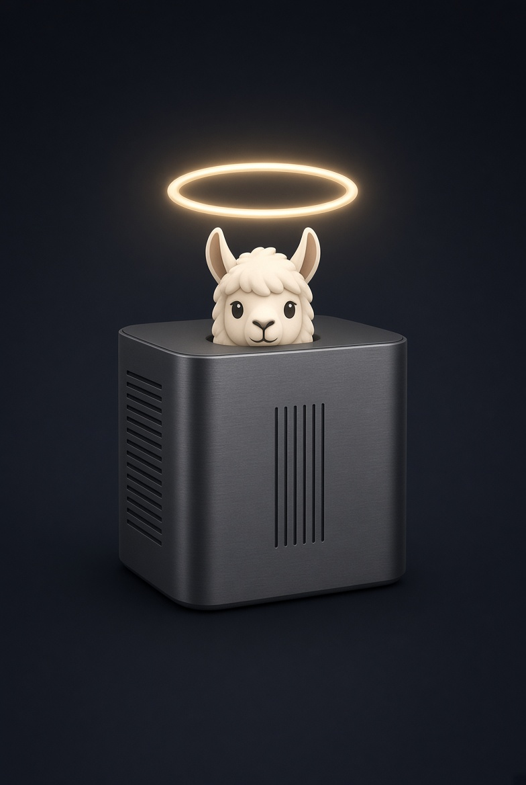

# halo-box/llama.cpp



<b>llama.cpp, close to mainline, with more</b>

[](https://opensource.org/licenses/MIT)

[upstream llama.cpp](https://github.com/ggml-org/llama.cpp) / [ggml](https://github.com/ggml-org/ggml) / [halo-box/strix-llama.cpp](https://github.com/halo-box/strix-llama.cpp)

## Halo Box

The goal is simple: more functionality, and the fastest llama.cpp for strix around. And help the community with a single fast
llama.cpp fork instead of many competing ones.

## What this is

A community fork of [`llama.cpp`](https://github.com/ggml-org/llama.cpp) that stays close to mainline. It tracks
upstream `master`, merges it in regularly, and adds features and speedups on top without changing how upstream
behaves. Upstream behaviour is unchanged - this is a superset, not a rewrite.

It is also the staging fork for the pair: anything general enough for upstream is developed here, on `halo/*`
branches, and submitted to `ggml-org/llama.cpp` from here under the upstream project's contribution and AI-usage
rules. What stays here is either not yet ready to go up, or too niche for mainline. Work that only makes sense on
AMD Strix Halo lives in [strix-llama.cpp](https://github.com/halo-box/strix-llama.cpp) instead.

## Quick start

Build from source. For example:

**Vulkan** (works on any recent GPU; on AMD, RADV on Mesa is the easiest path)

```sh
cmake -B build -DGGML_VULKAN=ON -DCMAKE_BUILD_TYPE=Release
cmake --build build --config Release -j
```

**ROCm / HIP** (needs ROCm installed; set `GPU_TARGETS` to your GPU, `gfx1151` is Strix Halo)

```sh
HIPCXX="$(hipconfig -l)/clang" HIP_PATH="$(hipconfig -R)" \
    cmake -B build -DGGML_HIP=ON -DGPU_TARGETS=gfx1151 -DCMAKE_BUILD_TYPE=Release
cmake --build build --config Release -j
```

Then:

```sh
# chat, pulling the model straight from Hugging Face
./build/bin/llama-cli -hf ggml-org/Qwen3.5-0.8B-GGUF

# OpenAI-compatible API server + web UI on http://localhost:8080
./build/bin/llama-server -hf ggml-org/Qwen3.5-0.8B-GGUF
```

Full build documentation, including Windows and Docker, is in [docs/build.md](docs/build.md).

## Running on Strix Halo

**Give the iGPU enough memory.** The APU's memory is shared, and the GPU can only use what the firmware and kernel let
it map. Two things control this: the UMA / dedicated-VRAM split in your BIOS, and the `amdgpu` GTT limit on Linux
(`amdgpu.gttsize`, in MB, and `ttm.pages_limit`, in 4 KB pages, as kernel command-line parameters). Which of those you
need depends on your kernel version - newer kernels size GTT more generously on their own. If a model that clearly
fits in RAM fails to allocate, this is almost always why.

**Measure things.** `GGML_VK_PERF_LOGGER=1` (any value) gives per-op timings on the Vulkan backend. `llama-bench`
and `llama-perplexity` are the tools for before/after numbers, and performance PRs here are expected to carry them.

Strix Halo specific notes and tuning (ROCm workarounds, Vulkan mat-vec chunking) are in the
[strix-llama.cpp README](https://github.com/halo-box/strix-llama.cpp#running-on-strix-halo).

## What differs from upstream

Everything else is upstream `llama.cpp`. The additions currently carried here:

**Strix Halo only** (lives here, measured on `gfx1151`)

| Change | Flag / switch | What it does |
| --- | --- | --- |
| Speculative prefill | `--spec-prefill` | A small draft model scores prompt tokens by attention importance so the target model only prefills the ones that matter, cutting time-to-first-token on long prompts |
| Adaptive speculative draft length | `--spec-draft-adaptive` | Sizes each draft from a measured per-sequence acceptance EMA rather than always drafting `--spec-draft-n-max`; speeds up MTP and DFlash |
| Vulkan fixes and tuning for RDNA 3.5 | | Driver-gated coopmat LDS stride padding, UMA bulk readback gated on host-cached mappings, IQ3_S mat-vec at batch sizes > 4, and a radix top-k kernel for large k |
| Hidden server presets | `hidden` in the models `.ini` | Keep a model loadable by name while omitting it from `GET /models` |
| Multi-point reasoning budget | `--reasoning-budget-*` (upstream has the hard budget only) | Intro message, two soft warnings, a grace period to finish a paragraph after the budget runs out, and reasoning-token usage telemetry |
| Vulkan batched mat-vec chunking | `GGML_VK_MMV_NO_SPLIT=1` to disable | Dispatches batched mat-vec at the column counts that actually scale on RDNA 3.5, instead of the slow NUM_COLS shader variants |
| ROCm/HIP quantized matmul on RDNA 3.5 | | MMQ/MMVQ tile configurations and register prefetching, compact `MUL_MAT_ID` with quant- and shape-specific tiles for 256-expert MoE prefill, fused activation quantization for Q8_0 and Q6_K decode |
| ROCm/HIP MoE decode fusion | `GGML_CUDA_DISABLE_WEIGHTED_DOWN=1`, `GGML_CUDA_DISABLE_MMID_512=1` | Fused routing, weighted expert reduction and shared-expert gate for Qwen3.5/3.6 and Ling style MoE |
| ROCm/HIP Gated DeltaNet | `GGML_CUDA_DISABLE_GDN_GATE=1` | DPP reductions and a tiled multi-column kernel for prefill; the whole conv -> norm -> gate -> recurrence -> state copy decode chain as one kernel |
| ROCm/HIP grouped decode matvecs | `GGML_CUDA_DISABLE_MMV_GROUP=1` | Consecutive single-column matvecs that read the same activation (gate/up pairs, hyper-connection projections) launch as one kernel |
| ROCm/HIP flash attention on RDNA 3.5 | | WMMA path for D=256 prefill at depth, Q8_0 KV tile kernel for decode |
| Speculative checkpoints on device | | `llama-server` keeps speculative-decoding checkpoints in device memory instead of copying them to the host |
| ROCmFPx quant types | `llama-quantize` types `Q4_0_ROCMFP4`, `Q4_0_ROCMFP4_FAST`, `Q2/Q3/Q6/Q8_0_ROCMFPX` and the `_LEAN`/`_COHERENT`/`_STRIX` recipes | Loads the ROCmFP4 GGUFs published for Strix Halo. CPU codecs plus Vulkan dequant, mat-vec, matmul and integer-dot kernels. Weight formats only: not accepted as KV-cache types |
| Repeatable output at depth | | Freed KV cells are zeroed so masked-out rows never carry stale K/V, and the Vulkan radix top-k assigns output slots deterministically |

Every ROCm/HIP change above is guarded on architecture, shape and layout, so other devices see upstream behaviour.
Run `--help`, or see [tools/server/README.md](tools/server/README.md), for the full options.

## Supported backends

All of upstream's, unmodified:

| Backend | Target devices |
| --- | --- |
| [Vulkan](docs/build.md#vulkan) | RADV on the RDNA 3.5 iGPU - the default recommendation |
| [HIP](docs/build.md#hip) | ROCm on `gfx1151` - see the `HIP_LAUNCH_BLOCKING` note above |
| [CPU](docs/build.md) | Zen 5 cores with AVX-512 - useful for offloading part of a model, though it shares bandwidth with the iGPU |
| [ZenDNN](docs/build.md#zendnn) | AMD CPU acceleration |
| [RPC](tools/rpc) | Distribute a model across several machines |

`llama.cpp` supports many more (CUDA, Metal, SYCL, CANN, OpenCL, WebGPU, ...); they are all still present in the tree
and unmodified. See the [upstream README](https://github.com/ggml-org/llama.cpp) for that list.

Most of the work in this fork is measured on AMD Strix Halo (Vulkan and HIP), and CI runs the standard upstream matrix.

## Documentation

#### Tools

- [cli](tools/cli/README.md)
- [completion](tools/completion/README.md)
- [server](tools/server/README.md)
- [GBNF grammars](grammars/README.md)

#### Development

- [How to build](docs/build.md)
- [Running on Docker](docs/docker.md)
- [Multi-GPU usage](docs/multi-gpu.md)
- [Performance troubleshooting](docs/development/token_generation_performance_tips.md)
- [GGML tips & tricks](https://github.com/ggml-org/llama.cpp/wiki/GGML-Tips-&-Tricks)
- [Completions](docs/completions.md)
- [Models](docs/models.md)

## Contributing

This is a small community project. A benchmark, a bug report, or a patch is exactly what it is for.

- This repo follows the upstream contribution and AI-usage rules, because what lands here is meant to go upstream.
  See [CONTRIBUTING.md](CONTRIBUTING.md) and [AGENTS.md](AGENTS.md); in short, understand every line you submit.
- Performance claims need numbers against a baseline you built and ran yourself, on the same machine in the same
  session.
- If your change is Strix Halo specific, send it to [strix-llama.cpp](https://github.com/halo-box/strix-llama.cpp)
  instead; that repo has its own, more permissive rules.
- Work lands on `halo/*` branches, and upstream is merged in regularly.

## Acknowledgements

This project is a fork and owes everything to the people who built what it forks:

- [ggml-org/llama.cpp](https://github.com/ggml-org/llama.cpp) and [ggml](https://github.com/ggml-org/ggml) - Georgi Gerganov and the llama.cpp contributors - MIT license
- [charlie12345/ROCmFPX](https://github.com/charlie12345/ROCmFPX) - the origin of the ROCmFPx project and the creator of the ROCmFP4 format - MIT license
- [ciru-ai/ROCmFPX](https://github.com/ciru-ai/ROCmFPX) - a fork of the above, and the tree the ROCmFPx quant formats and reference codecs here were hand-ported from (it shares no git history with llama.cpp, so it cannot be merged) - MIT license
- [yhirose/cpp-httplib](https://github.com/yhirose/cpp-httplib) - Single-header HTTP server, used by `llama-server` - MIT license
- [nothings/stb](https://github.com/nothings/stb) - Single-header image format decoder, used by multimodal subsystem - Public domain
- [nlohmann/json](https://github.com/nlohmann/json) - Single-header JSON library, used by various tools/examples - MIT License
- [mackron/miniaudio](https://github.com/mackron/miniaudio) - Single-header audio format decoder, used by multimodal subsystem - Public domain
- [sheredom/subprocess.h](https://github.com/sheredom/subprocess.h) - Single-header process launching solution for C and C++ - Public domain
